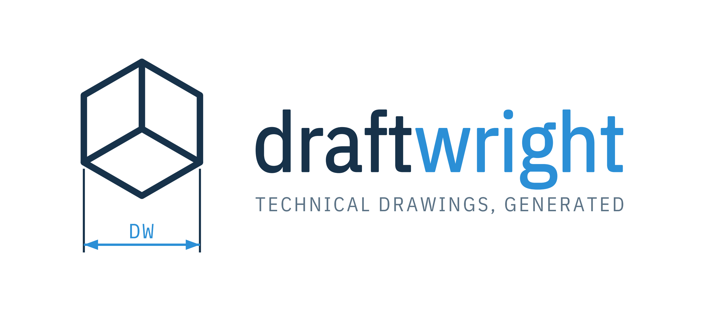
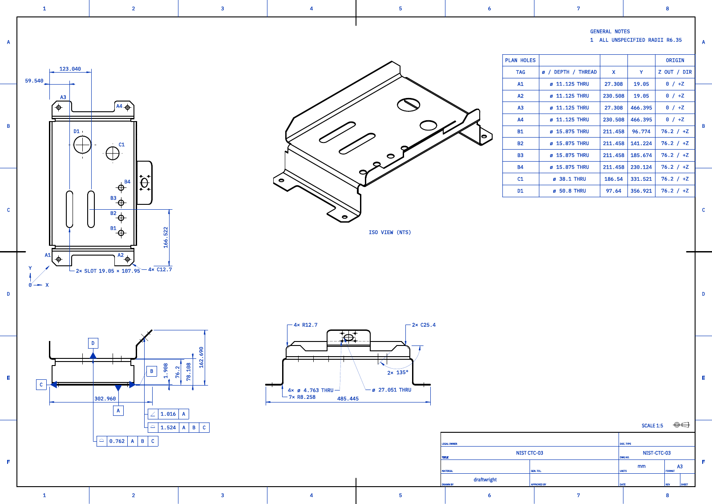
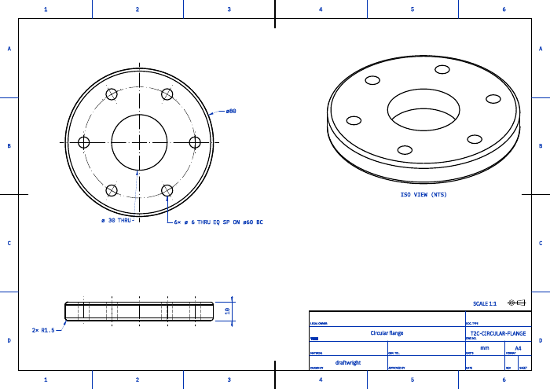
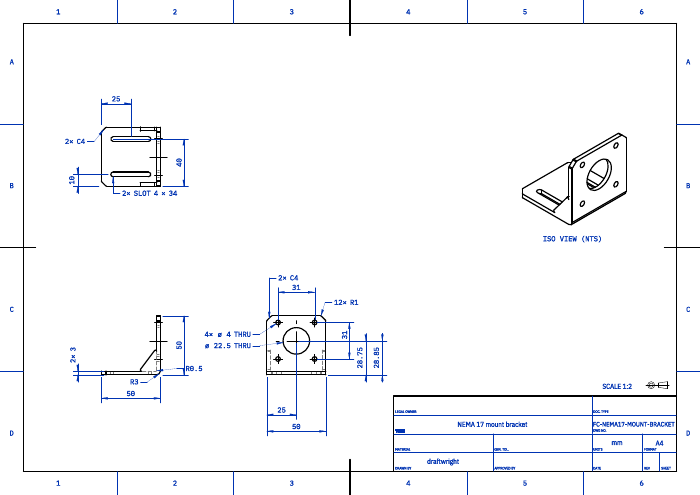
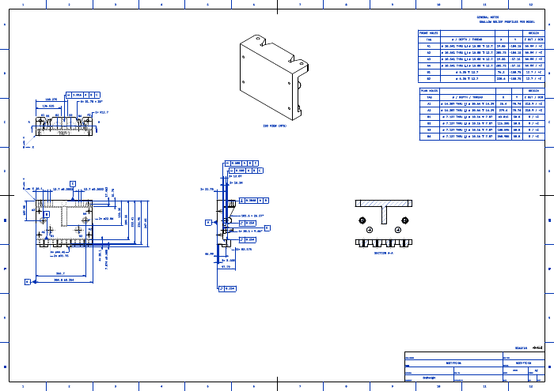

<p align="center">
  
</p>

<p align="center">
  <a href="https://crates.io/crates/draftwright"></a>
  <a href="https://github.com/pzfreo/draftwright/actions/workflows/ci.yml"></a>
  <a href="LICENSE"></a>
</p>

**Draftwright turns a 3D STEP file into a complete, dimensioned engineering drawing.** It
recognises the part's features (holes, patterns, slots, pockets, turned steps, threads),
decides what to dimension and where, reads tolerances and GD&T from AP242 files, lays out the
views on a standard sheet, and tells you anything it could not state. One Rust binary, one
command, one repeatable drawing.

<p align="center">
  
  <br>
  <sub>NIST CTC-03, drawn from its AP242 STEP file with only the title set. Every view, dimension,
  hole-table entry, datum and GD&amp;T frame is placed automatically.</sub>
</p>


## Python

```sh
pip install draftwright
```

```python
from draftwright import make_drawing
svg_path, pdf_path = make_drawing("part.step", out="drawing", title="Bracket")
```

STEP paths and build123d shapes are supported (install build123d separately for
shapes). The wheel also installs `draftwright` and `draftwright-mcp` on PATH.

**Changed from 0.4:** `make_drawing` returns `(svg_path, pdf_path)` as strings;
the second file is now **PDF, not DXF**. Editable DXF is available through `draftwright render --formats dxf`; the other old Python
classes/functions are unavailable. Unsupported options with non-default values
raise `TypeError`; old names/imports give migration guidance. Pin
`draftwright<0.6` to keep the old API. The Rust engine uses a [Spec](docs/model.md).
See the [Python API, keyword mapping and interrupt behaviour](docs/python.md).

## Ways to use it

- **In the browser:** [draftwright.io](https://draftwright.io). Open a STEP file, see the drawing,
  move and edit dimensions, add requirements, and export PDF or STEP. The whole engine runs in
  the browser as WebAssembly.
- **With an AI agent:** the hosted MCP server at `mcp.draftwright.io` lets Claude, ChatGPT and
  other MCP clients open parts, read drawings and make changes. See [docs/mcp.md](docs/mcp.md).
- **On the command line:** `draftwright render part.step -o part` (below).
- **From Rust:** the `draftwright` crate's five stateless operations (`analyse`, `plan`, `edit`,
  `render`, `review`). See [docs/model.md](docs/model.md).

## Install

With a recent stable Rust toolchain:

```sh
cargo install draftwright        # installs draftwright and draftwright-mcp
```

Without Rust, download a ready-built archive for macOS (Apple silicon), Linux x86_64 or
Windows x86_64 from the [latest release](https://github.com/pzfreo/draftwright/releases/latest).

From 0.6.0, the same two commands install from PyPI without Rust:

```sh
uv tool install draftwright      # or: pipx install draftwright
```

PyPI releases before 0.6 use the archived
[Python implementation](https://github.com/pzfreo/draftwright-python). Starting with
0.6, this Rust project provides both commands and the small
[Python API](docs/python.md). Pin `draftwright<0.6` to keep the full old API.
The old command form `draftwright part.step [options]` still renders a drawing;
see [CLI migration](docs/cli-migration.md) for the options it keeps.

Shell completion: `draftwright completions zsh` (or `bash`, `fish`, `powershell`, `elvish`)
prints a completion script; see [docs/engine.md](docs/engine.md#using-it) for where to put it.

## Quick start

```sh
draftwright render part.step -o part                     # part.svg and part.pdf
draftwright render part.step -o part --shaded --below    # shaded views from above and below
draftwright render part.step -o part --formats pdf,png   # choose formats
draftwright review part.step                             # the drawing as text, with what it could not state
```

A drawing is adjusted with a **Spec**: a small JSON file naming only what you want different
from the automatic drawing. For example, to fill in the title block:

```json
{ "sheet": { "title": { "title": "Mounting plate", "number": "MP-001" } } }
```

```sh
draftwright render part.step --spec part.drawing.json -o part
draftwright spec part.pdf            # every drawing carries its Spec; this reads it back
```

More:

```sh
draftwright diff old.step new.step --spec part.drawing.json -o changes   # carry a drawing to a new revision
draftwright pack assembly.step -o pack                                   # drawings and parts list for an assembly
draftwright --help
```

## What it does

- **Recognises features** from the B-rep with [quiddity](https://github.com/pzfreo/quiddity):
  holes and counterbores, hole patterns, slots, pockets and recesses, turned steps, grooves,
  chamfers and fillets, threads. Anything it cannot read is reported, not guessed.
- **Dimensions completely.** Each feature family has its own rules. Dimensions are placed
  without collisions, and every omission is reported with a reason.
- **Reads PMI.** Tolerances, fits, datums, GD&T frames, threads and surface finish come from
  AP242 semantic PMI. [Specify](https://github.com/pzfreo/specify-core) writes requirements back
  into STEP.
- **Lays out sheets.** Views, sections, detail views and hole tables go on ISO 5457 sheets with
  an ISO 7200 title block. Sheet size and scale are chosen automatically, using more sheets when
  needed.
- **Is deterministic.** The same inputs give the same bytes. SVG and PDF carry real, searchable
  text and embed the Spec that made them.
- **Handles assemblies.** `pack` draws each made part once and writes an ISO 7573 parts list,
  item numbers and a CSV/JSON bill of materials.
- **Tracks revisions.** `diff` carries a drawing's edits to a new revision of the part and marks
  up what changed.

## Examples

Drawings of NIST test parts, FreeCAD and build123d parts, and assemblies, rebuilt by CI on every
release, are in **[pzfreo/dw-examples](https://github.com/pzfreo/dw-examples)**.

<table>
  <tr>
    <td><a href="https://github.com/pzfreo/dw-examples/tree/main/drawings/t2c-circular-flange"></a></td>
    <td><a href="https://github.com/pzfreo/dw-examples/tree/main/drawings/nema17-mount-bracket"></a></td>
    <td><a href="https://github.com/pzfreo/dw-examples/tree/main/drawings/nist-ftc-06"></a></td>
  </tr>
  <tr>
    <td align="center"><sub>Flange: bolt circle callout</sub></td>
    <td align="center"><sub>Bracket: slots, chamfers, fillets</sub></td>
    <td align="center"><sub>NIST FTC-06: hole tables, GD&amp;T, section</sub></td>
  </tr>
</table>

## Documentation

- [Engine guide](docs/engine.md): building, the full command line, what is and isn't supported,
  known limitations, checking a change
- [Model and Spec reference](docs/model.md): the Analysis, Spec and Plan, and every setting
- [Python API and migration](docs/python.md)
- [MCP and agents](docs/mcp.md)
- [Browser / WASM package](docs/wasm.md)
- [Thread callouts](docs/thread-callouts.md) · [Bills of materials](docs/bom.md) ·
  [Finding impact](docs/finding-impact.md)
- [Changelog](CHANGELOG.md)

## Status

Draftwright is young and moving quickly: 0.2.x releases come every few days. Drawings report what
they do not state, but dense parts can still be less tidy than a hand-made drawing; see
[Known limitations](docs/engine.md#known-limitations). Issues and example parts are welcome.

## Related projects

- [quiddity](https://github.com/pzfreo/quiddity): feature recognition from STEP B-rep, and the
  haecceity geometry kernel Draftwright is built on.
- [Specify](https://github.com/pzfreo/specify-core): writes requirements (tolerances, fits, GD&T,
  BOM data) into STEP as AP242 PMI. It is the Specify view at
  [draftwright.io/specify](https://draftwright.io/specify).
- [dw-examples](https://github.com/pzfreo/dw-examples): the example drawings.
- [draftwright-python](https://github.com/pzfreo/draftwright-python): the original Python
  implementation, no longer developed.

## Licence and contributing

Draftwright is licensed under the [GNU AGPL v3.0](LICENSE), and is also available under
separate commercial terms; contact paul@draftwright.io. quiddity and haecceity are Apache-2.0.
The bundled IBM Plex fonts are under the SIL Open Font License 1.1.

Contributions are welcome. See [CONTRIBUTING.md](CONTRIBUTING.md); pull requests need the
[Contributor License Agreement](CLA.md).
