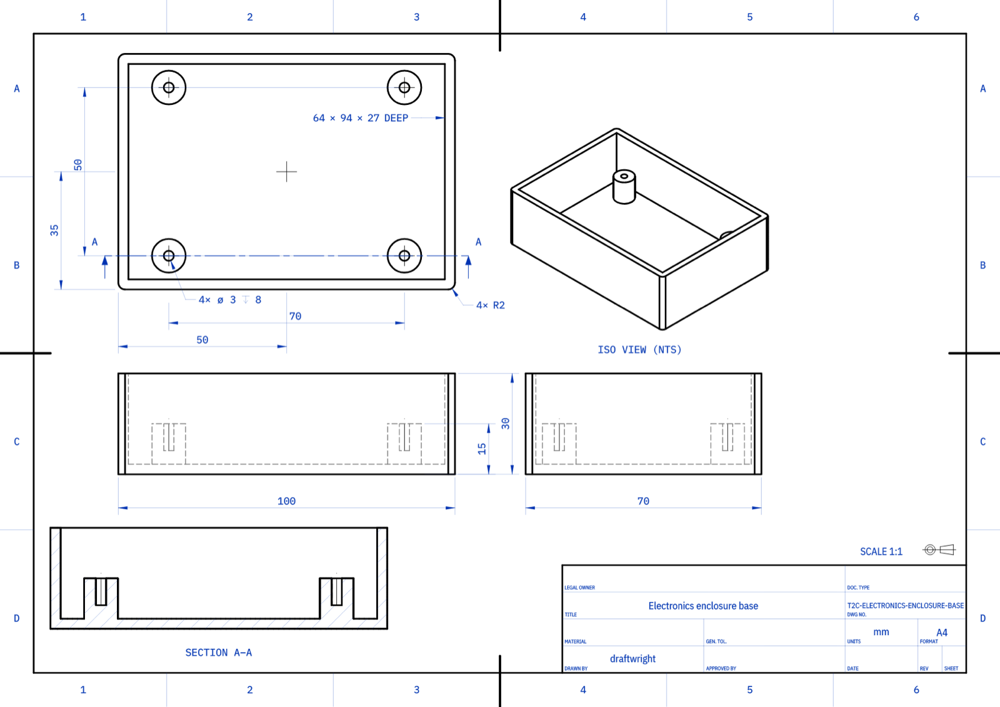

<p align="center">
  
</p>

<p align="center">
  <a href="https://crates.io/crates/draftwright"></a>
  <a href="https://github.com/pzfreo/draftwright/actions/workflows/ci.yml"></a>
  <a href="LICENSE"></a>
</p>

Draftwright turns a STEP model into a dimensioned engineering drawing: SVG, PDF or editable
DXF. It recognises manufacturing features, reads requirements from the STEP file, chooses
views and dimensions, and lays them out on standard sheets. It reports what it could not state.

<p align="center">
  
  <br>
  <sub>An electronics enclosure base made by a text-to-CAD tool, drawn by 0.6.0-alpha.2 from its STEP
  file with only the title set. Every view, dimension and callout is placed automatically.</sub>
</p>

**Contents:** [Examples](#examples) · [Install](#install) · [Command line](#command-line) · [Output and the Spec](#output-and-the-spec) · [Python](#python) · [What it does](#what-it-does) · [Assemblies and revisions](#assemblies-and-revisions) · [With agents](#with-agents) · [Documentation](#documentation) · [How it's built](#how-its-built) · [Related projects](#related-projects) · [Licence and contributing](#licence-and-contributing)

0.6.0 is in alpha (pre-release); the current version is **0.6.0-alpha.2**. The Rust half of
the build123d API remains to be completed; layout regressions are tracked in
[#452](https://github.com/pzfreo/draftwright/issues/452).

## Examples

To see what draftwright does with real parts, browse
**[pzfreo/dw-examples](https://github.com/pzfreo/dw-examples)**: NIST test parts, FreeCAD
library parts, text-to-CAD and build123d parts, and assemblies, each drawn by the stock CLI with
only a title block set. They are unreviewed output, mistakes included, and each drawing's
`.review.json` lists what draftwright found it could not state. Its CI rebuilds them whenever the
pinned draftwright release is bumped.

<table>
  <tr>
    <td><a href="https://github.com/pzfreo/dw-examples/blob/main/drawings/t2c-circular-flange/t2c-circular-flange.pdf"></a></td>
    <td><a href="https://github.com/pzfreo/dw-examples/blob/main/drawings/nema17-mount-bracket/nema17-mount-bracket.pdf"></a></td>
    <td><a href="https://github.com/pzfreo/dw-examples/blob/main/drawings/nist-ftc-06/nist-ftc-06.pdf"></a></td>
  </tr>
  <tr>
    <td align="center"><sub>Flange: bolt circle callout</sub></td>
    <td align="center"><sub>Bracket: slots, chamfers, fillets</sub></td>
    <td align="center"><sub>NIST FTC-06: hole tables, GD&amp;T, section</sub></td>
  </tr>
</table>

## Install

These commands select the pre-release; unqualified installs can select older releases.

| You use | Install | Platforms |
| --- | --- | --- |
| **Python 3.9+ (abi3)** | `pip install --pre draftwright` ([PyPI](https://pypi.org/project/draftwright/), [Python guide](docs/python.md)); no Rust needed | Linux x86_64 and aarch64, macOS arm64 and x86_64, Windows x64 |
| **Command line** | `uv tool install --prerelease allow draftwright`; installs `draftwright` and `draftwright-mcp` | The same five wheel platforms |
| **Rust crate** | `cargo install draftwright --version 0.6.0-alpha.2` for both binaries; `draftwright = "=0.6.0-alpha.2"` for the library ([operations](docs/model.md#the-five-operations)) | Native Rust toolchain |
| **Prebuilt archives** | Download a CLI archive from [Releases](https://github.com/pzfreo/draftwright/releases); includes both binaries, schemas and agent docs | macOS arm64, Linux x86_64, Windows x64 |
| **Browser** | [draftwright.io](https://draftwright.io) | WebAssembly ([package guide](docs/wasm.md)) |

0.6 replaces the old Python package of the same name; pin `draftwright<0.6` to keep it.

## Command line

```sh
draftwright render part.step -o part --formats svg,pdf,dxf  # includes editable DXF in alpha.2
draftwright render part.step -o part --units in --paper ansi
draftwright review part.step
```

`review` prints JSON containing the drawing as SVG text, the problems and lint's findings.
The [engine guide](docs/engine.md#using-it) covers the full command line, including
`--shaded`, `--below` and paper choices. `draftwright completions zsh` prints a completion
script; the same guide gives installation commands and the other supported shells.

## Output and the Spec

A **Spec** is a small JSON file of drawing settings and edits. Without one, draftwright uses
its automatic choices. `render` writes `part.svg`, `part.pdf` and `part.dxf` for the first
command above (SVG and PDF by default); PNG is also available. Extra sheets get numbered
files, while PDF holds all the sheets. Each format embeds the Spec that made it, and the
command prints JSON listing the files and problems.

For example, save this as `part.drawing.json` to fill in the title block:

```json
{ "sheet": { "title": { "title": "Mounting plate", "number": "MP-001" } } }
```

```sh
draftwright render part.step --spec part.drawing.json -o part
draftwright spec part.pdf  # read the embedded Spec
```

The [model and Spec reference](docs/model.md) describes the settings, documents and Rust API.

## Python

```python
from draftwright import make_drawing, Part
svg, dxf = make_drawing("part.step", out="drawing", title="Bracket")
from build123d import Box
part = Part(Box(120, 80, 20), "plate", title="Mounting plate")
svg, dxf = part.drawing(sheet="A3").render("plate")
```

Install build123d separately for shapes and `Part`. See the [Python guide](docs/python.md)
for requirements, layout edits and the parts of the build123d API still being completed.

Moving from 0.4: see [Python migration](docs/python.md#migrating-from-python-0-4) and [CLI migration](docs/cli-migration.md).

## What it does

- **Recognises features** with [quiddity](https://github.com/pzfreo/quiddity): holes,
  counterbores, patterns, slots, pockets, turned steps, grooves, chamfers, fillets and threads.
- **Dimensions features** with rules for each family; omissions and placement failures are
  reported with a reason.
- **Reads AP242 PMI (tolerances and GD&T stored in the STEP file)**, including fits, datums,
  threads and surface finish. Unsupported requirements are reported.
- **Lays out sheets** with views, sections, details, hole tables and an ISO 7200 title block;
  it chooses scale and paper size, using more sheets when needed.
- **Produces deterministic output:** the same inputs give the same bytes. SVG and PDF carry
  real, searchable text; DXF has editable text, dimensions, blocks and title-block attributes.

## Assemblies and revisions

```sh
draftwright pack assembly.step -o pack
draftwright diff old.step new.step --spec part.drawing.json -o changes
```

`pack` draws each made part once and writes an ISO 7573 parts list, item numbers and a CSV/JSON
bill of materials. `diff` carries the Spec to a new revision, marks up what changed and reports
edits that need a decision. See [bills of materials](docs/bom.md) and [the engine guide](docs/engine.md#using-it).

## With agents

The CLI release archives include **`draftwright-mcp`**, a local stdio MCP server for Claude
and other MCP clients; the wheel and Cargo installs provide it too. Clients can inspect a
part, edit its Spec, render the drawing and read the findings. The [MCP guide](docs/mcp.md)
also covers the newer local `draftwright mcp-stdio` and `draftwright mcp-http` adapters.

The Spec is the steering surface: an agent inspects the drawing and findings, changes settings
or edits by item ID, then renders and reviews again. Requirements belong in STEP; the Spec
controls the drawing.

## Documentation

- [Engine guide](docs/engine.md): building, the full command line, what is and isn't supported,
  known limitations, checking a change
- [Model and Spec reference](docs/model.md): the Analysis, Spec and Plan, and every setting
- [Python API and migration](docs/python.md)
- [MCP and agents](docs/mcp.md)
- [Browser / WASM package](docs/wasm.md)
- [Thread callouts](docs/thread-callouts.md) · [Bills of materials](docs/bom.md) ·
  [Finding impact](docs/finding-impact.md)
- [Changelog](CHANGELOG.md)

## How it's built

Draftwright is AI-coded with Claude and Codex, directed by its maintainer. Large changes get
independent review. The output is deterministic, and the public examples are built by the
stock CLI with no hand edits.

## Related projects

- [quiddity](https://github.com/pzfreo/quiddity): feature recognition from STEP B-rep, built on
  the haecceity geometry kernel that draftwright uses.
- [Specify](https://github.com/pzfreo/specify-core): writes tolerances, fits, GD&T and BOM data
  into STEP as AP242 PMI; available at [draftwright.io/specify](https://draftwright.io/specify).
- [dw-examples](https://github.com/pzfreo/dw-examples): the public example drawings.
- [draftwright-python](https://github.com/pzfreo/draftwright-python): the earlier Python
  implementation, being retired.

## Licence and contributing

Draftwright is licensed under the [GNU AGPL v3.0](LICENSE), and is also available under
separate commercial terms; contact paul@draftwright.io. quiddity and haecceity are Apache-2.0.
The bundled IBM Plex fonts are under the SIL Open Font License 1.1.

Contributions are welcome. See [CONTRIBUTING.md](CONTRIBUTING.md); pull requests need the
[Contributor License Agreement](CLA.md).
