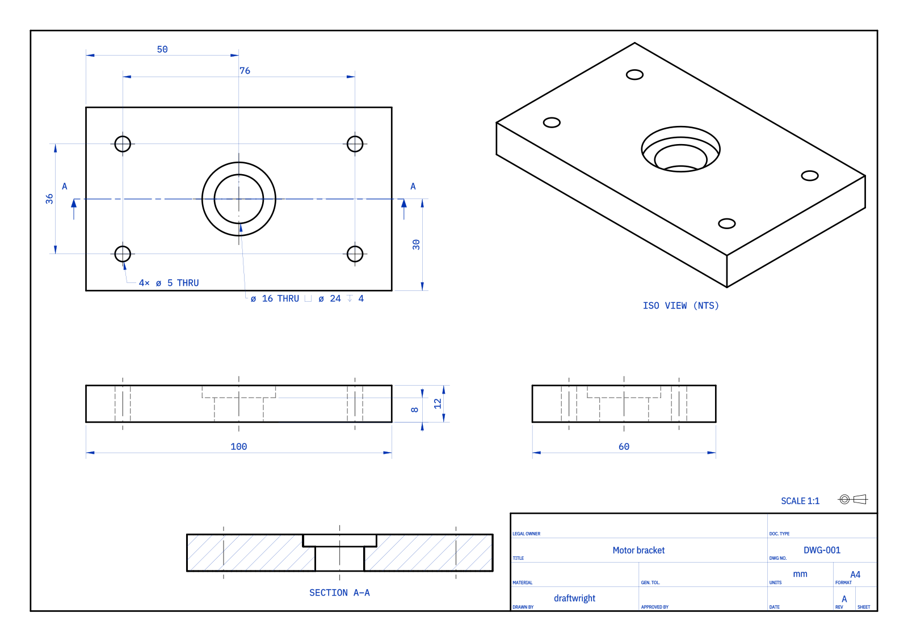
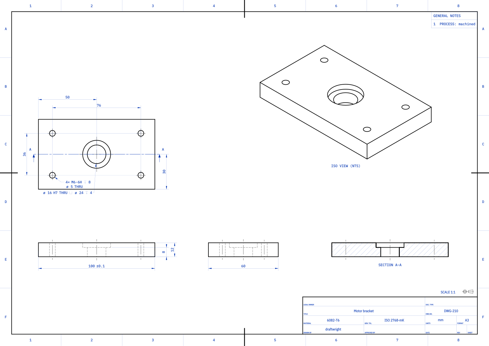
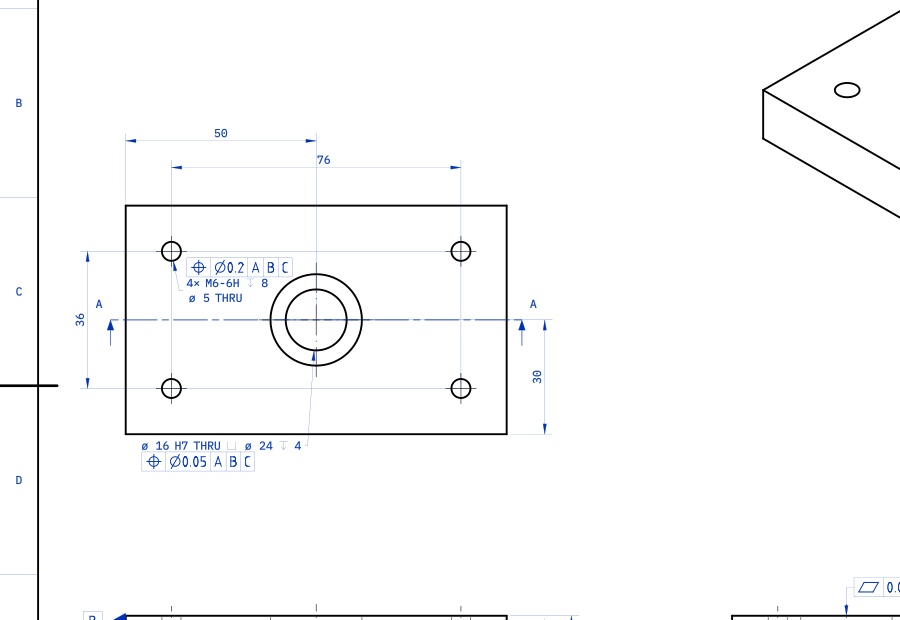
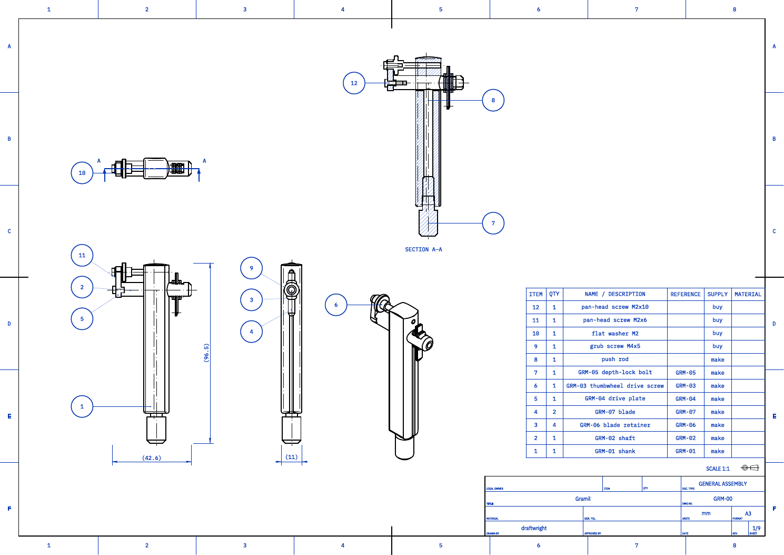

# Drawings from build123d

Draftwright turns a build123d part into a manufacturing drawing: views, dimensions,
hole and thread callouts, GD&T frames, surface finish, notes and a title block. You
state requirements in the same script that builds the faces; the engine does the
layout. This page starts with a bare shape and builds one part up in three steps,
then covers assemblies. The
[Python reference](python.md) has every call, argument and error in detail.

Using a coding agent? Give it the
[draftwright-build123d skill](../skills/draftwright-build123d/SKILL.md): the same
workflow, plus the checks and traps agents have met in practice. For Claude Code, copy
the folder to `.claude/skills/` in your project or to `~/.claude/skills/`.

## Install

```sh
pip install "draftwright[build123d]"
# or, without installing anything:
uv run --with draftwright --with build123d script.py
```

build123d 0.10 or later is required; 0.10.0 and 0.13.0 are tested, on Python 3.12.
With 0.10, also install `ocp-gordon<0.3`.

`from build123d import *` also defines a `Part`; importing draftwright's `Part` after
it replaces build123d's. The examples here do that deliberately. In a script that
needs both, use `import draftwright as dw` and `dw.Part`.

All three steps use this bracket:

```python
from build123d import *
from draftwright import make_drawing, Part

with BuildPart() as bracket:
    Box(100, 60, 12)
    with Locations((0, 0, 6)):
        bore = CounterBoreHole(radius=8, counter_bore_radius=12, counter_bore_depth=4)
    with GridLocations(76, 36, 2, 2):
        tapped = Hole(radius=2.5)          # Ø5.0, the M6 tap drill
```

## Step 1: a drawing from the shape alone

```python
svg, dxf = make_drawing(bracket.part, out="step1", title="Motor bracket")
```



With nothing but the shape, the engine recognises the counterbore and the hole
pattern, then chooses views, a section, scale, sheet and dimensions. Every size is
measured; nothing says how accurate it must be. The DXF opens in CAD with live
dimensions.

## Step 2: state the sizes that matter

Wrap the shape in a `Part` and state what the shop must hold. Refer to the faces by
the build123d objects you modelled: a hole, a face, a list of faces or the cutting
shape.

```python
p = Part(bracket.part, "bracket", number="DWG-210", title="Motor bracket")
p.process("machined").material("6082-T6").general_tolerance("ISO 2768-mK")

bearing = p.hole(bore).fit("H7")            # keep the handle for step 3
p.holes(tapped).thread("M6", depth=8)       # minimum full-thread depth
ends = bracket.faces().sort_by(Axis.X)
p.distance(ends[0], ends[-1]).tolerance(plus_minus=0.1)

dwg = p.drawing(sheet="A3", scale=1)        # pin the sheet so the steps compare
svg, pdf = dwg.render("step2", formats=("svg", "pdf"))
```



The bore now reads `⌀16 H7`, the four holes `4× M6-6H ↧ 8` over their `⌀5` drill, and
the length `100 ±0.1`. Material, general tolerance and process fill the title block
and notes. Other size calls:

| Call | Prints |
| --- | --- |
| `hole(h).fit("H7")`, `shaft(face).fit("h6")` | ISO 286 fit |
| `cylinder(face).diameter(plus_minus=0.02)` or `limits=(9.98, 10.04)` | toleranced diameter |
| `distance(face1, face2).tolerance(...)` | toleranced length between parallel faces |
| `angle(face1, face2).tolerance(plus_minus=0.5)` | toleranced angle, in degrees |
| `hole(h).thread("M6", depth=12)`, `shaft(face).thread("M10x1.5-6g")` | metric thread; coarse pitch and `6H`/`6g` by default |
| `shaft(face).knurl(0.8, "straight")` | knurl, with the tooth count derived from diameter and pitch |

`hole()` takes one hole and `holes()` a group. Calls chain, and repeating a call on
the same faces replaces it. Mistakes raise at the call: an unknown fit class, a
thread that does not suit the drill, a face that is not on the part.

## Step 3: datums, GD&T and surface finish

Continue with the same `Part` and drawing:

```python
A = p.datum("A", bracket.faces().sort_by(Axis.Z)[0])
B = p.datum("B", ends[0])
C = p.datum("C", bracket.faces().sort_by(Axis.Y)[0])

bearing.position(0.05, A, B, C)
p.holes(tapped).position(0.2, A, B, C)
p.face(bracket.faces().sort_by(Axis.Z)[-1]).flatness(0.05)
p.note("Break all sharp edges 0.2 max.").default_finish(3.2)

dwg.title(drawn_by="PA", date="2026-11-16", revision="A")
svg, pdf = dwg.render("step3", formats=("svg", "pdf"))

for f in dwg.problems:
    print(f["tier"], f["code"], f["message"])
```


Datum symbols A, B and C, the two position frames, the flatness frame and the
part-wide Ra 3.2 are added, and the note joins the notes table. A finish on one
surface is `face(f).finish(1.6)` or `hole(h).finish(1.6)`.

Also available: `perpendicularity`, `parallelism`, `cylindricity`,
`circular_runout`, `total_runout`, `profile_surface` and `concentricity`. Declare a
datum before using it; a control cannot reference a datum on its own faces.

`dwg.problems` lists what the engine could not state cleanly, each with a `tier`:

- `fix_before_printing`: wrong or ambiguous. Fix it before the drawing is used.
- `tidy`: readable but crowded or crossing. Worth a look.
- `information`: context, such as why the scale changed.

Read `problems` after `render()`. Changing the Part or the layout clears it until
you render again.

## Changing the layout

Layout belongs to the drawing, never the Part:

```python
dwg = p.drawing(sheet="A2", scale=1).views(shaded=True)
dwg.section("A-A", through=bearing)                # a handle from a Part call
dwg.update({"sheet": {"zones": False}})            # any Spec setting
dwg.render("review", formats=("pdf",), spec={"sheet": {"title": {"revision": "B"}}})
```

`update()` accepts any [Spec](model.md) setting and checks it against the schema.
Requirements such as material, fits and GD&T are refused there, with a pointer to
the matching Part call, so each fact has one home.

### Moving a callout

Each dimension and callout has an id, and `place` moves it. The ids appear in the
`subjects` of `dwg.problems`; for a hole callout it is `"d:" + p.feature_id(hole) +
"/bore.diameter"`. In step 3 the `⌀16 H7` leader crosses a `⌀5` hole
(`leader_through_feature`). Asking for the side below the plan view clears it:

```python
callout = "d:" + p.feature_id(bearing) + "/bore.diameter"
dwg.update({"dimensions": {callout: {"place": {"view": "plan", "side": "below"}}}})
```



`side` keeps the engine choosing a clear spot on that side. `lane` and `along` fix
the position, and `{"pinned": True, "offset": [dx, dy]}` sets the bend in paper mm
from where the engine put it. A pinned label is never moved to avoid other ink, so
check `problems` afterwards. The [placement reference](model.md#placement-place-s3)
lists every field.

## Assemblies

A `Pack` draws a general-assembly sheet with balloons and a parts list, then a sheet
for each made part, as one PDF plus a CSV/JSON bill of materials. From a STEP file:

```python
from draftwright import Pack

pack = Pack("gramil-assembly.step", title="Gramil", number="GRM-00")
pdf, csv = pack.render("gramil", formats=("pdf", "csv"))
```



That is the first page of the gramil's nine-page pack: balloons and a parts list
with made and bought parts (the screws and washer are recognised as bought), then
a drawing for each made part. The model's orientation is kept by default: source X
across the sheet and Z up, so the gauge is drawn standing up as it was modelled.
`horizontal_axis="x"`, `"y"` or `"z"` explicitly selects the source axis across the
sheet to turn the assembly.

From build123d, pass a `Compound` whose children are labelled with the `Part`
names, and the Parts that carry requirements:

```python
base_shape.label, lid_shape.label = "base", "lid"
assembly = Compound(children=[base_shape, lid_shape])
pack = Pack(assembly, parts=[base, lid], title="Enclosure", number="ASM-100",
            horizontal_axis="x")
pack.title(drawn_by="PA", date="2026-11-16", revision="A")
pdf, csv, json_path = pack.render("enclosure", formats=("pdf", "csv", "json"))

for f in pack.findings:
    print(f.get("part", "GA"), f["severity"], f["message"])
```

Supplied Parts are drawn with their requirements; other products are drawn from
geometry. If one part fails, the rest still render and the failure appears in
`pack.findings` with severity `error`. The
[Python reference](python.md#assembly-drawing-packs-pack) has a complete
example you can run.

## Not yet available

- Writing requirements into an AP242 STEP file. `export_step()` writes geometry only.
- Chamfer requirements. Modelled chamfers are still recognised and dimensioned.
- Diagonal knurls.
- Distances between faces not normal to X, Y or Z, and angles outside a principal view.

## Troubleshooting

| Message | Cause and fix |
| --- | --- |
| `DraftwrightError` naming build123d versions | build123d is older than 0.10. Upgrade it. |
| `No module named 'OCP.collections'` on build123d 0.10 | Install `ocp-gordon<0.3`. |
| `thread M6 does not match the measured internal cylinder diameter` | The drill does not suit that thread; M6 needs Ø5.0. |
| `hole(): the object holds 4 separate holes` | Use `holes()` for a group. |
| `Drawing.problems requires render() first` | Render again after changing the Part or the layout. |
| `... is a requirement: use Part.material() ...` from `update()` | That key is a requirement, not layout. Use the Part call it names. |
