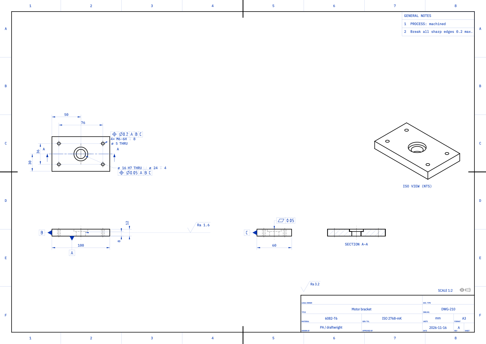

# Drawings from build123d

Draftwright turns a build123d part into a manufacturing drawing: views, dimensions,
hole and thread callouts, GD&T frames, surface finish, notes and a title block. You
state the requirements in the same script that builds the faces; the engine works out
the layout. This page covers what is supported and how to use it. The
[Python reference](python.md) has every call, argument and error in detail.

## What is supported

| Area | Status (0.6.0 alpha) |
| --- | --- |
| build123d versions | 0.10 and later; tested on 0.10.0 and 0.13.0 with Python 3.12. With 0.10, also pin `ocp-gordon<0.3`. |
| Drawing a shape | Any build123d `Shape`: `make_drawing(shape)` or `Part(shape, ...).drawing()` |
| Part details | process, material, general tolerance, notes, default surface finish |
| Sizes | hole and shaft fits (ISO 286), ± and limit tolerances on diameters, distances between parallel faces, angles between faces |
| Threads | metric internal and external (`M6`, `M10x1.5-6g`), with an optional minimum full-thread depth for tapped holes |
| GD&T | datums; position, flatness, perpendicularity, parallelism, cylindricity, circular and total runout, surface profile, concentricity |
| Other | surface finish (Ra) per face; straight and diamond knurls |
| Layout | sheet size, scale, units, shaded views, omitted views, sections, title block, any [Spec](model.md) layout setting |
| Assemblies | `Pack`: a general-arrangement sheet plus a sheet for each made part, with a BOM as CSV/JSON |
| Output | SVG, PDF, PNG and editable DXF |

Not yet available:

- Writing the requirements into an AP242 STEP file. `export_step()` writes geometry only.
- Chamfer requirements. Modelled chamfers are still recognised and dimensioned.
- Diagonal knurls.
- Distances between faces that are not normal to X, Y or Z, and angles that do not lie in a principal view.

**CadQuery:** CadQuery and build123d cannot be installed in the same environment
(their OCP builds conflict), so `Part` is build123d only. A CadQuery model can still
be drawn from its STEP file: `cq.exporters.export(model, "part.step")`, then
`make_drawing("part.step")`.

## Install

```sh
pip install --pre "draftwright[build123d]"
# or, without installing anything:
uv run --with draftwright --prerelease=allow --with build123d script.py
```

Draftwright does not import build123d until you hand it a shape, so STEP-only
scripts do not need build123d at all.

## How to

### Draw a part with no requirements

```python
from build123d import Box
from draftwright import make_drawing

svg, dxf = make_drawing(Box(100, 60, 12), out="block", title="Spacer block")
```

The engine recognises holes, pockets, slots, steps and chamfers, then chooses the
views, scale, sheet and dimensions. This is the quickest way to see what it makes
of your geometry.

### State requirements on the faces you modelled

Wrap the part in a `Part` and keep hold of the build123d objects you will refer to.
A hole object, a face, a list of faces or the cutting shape all work; Draftwright
matches them to the part's own faces.

```python
from build123d import *
from draftwright import Part

with BuildPart() as bracket:
    Box(100, 60, 12)
    with Locations((0, 0, 6)):
        bore = CounterBoreHole(radius=8, counter_bore_radius=12, counter_bore_depth=4)
    with GridLocations(76, 36, 2, 2):
        tapped = Hole(radius=2.5)   # Ø5.0, the M6 tap drill

p = Part(bracket.part, "bracket", number="DWG-210", title="Motor bracket")
p.process("machined").material("6082-T6").general_tolerance("ISO 2768-mK")
p.note("Break all sharp edges 0.2 max.").default_finish(3.2)

A = p.datum("A", bracket.faces().sort_by(Axis.Z)[0])
B = p.datum("B", bracket.faces().sort_by(Axis.X)[0])
C = p.datum("C", bracket.faces().sort_by(Axis.Y)[0])

bearing = p.hole(bore).fit("H7").finish(1.6).position(0.05, A, B, C)
p.holes(tapped).thread("M6", depth=8).position(0.2, A, B, C)
p.face(bracket.faces().sort_by(Axis.Z)[-1]).flatness(0.05)
```

Points to know:

- Calls chain and return a handle you can keep (`bearing` above) for sections and
  further requirements. Repeating a call on the same faces replaces the earlier value.
- `hole()` takes one hole; `holes()` takes a group and prints `4×`.
- `thread("M6", depth=8)` sets the minimum full-thread depth and prints
  `M6-6H ↧ 8`. Leave out `depth` to thread the whole hole. The pitch and class
  default to ISO coarse and `6H`/`6g`.
- A datum must be declared before it is used, and a control cannot use a datum on
  its own faces.
- Mistakes raise at the call, not at render time: an unknown fit class, a thread
  that does not match the drill, or a face that is not part of the part.

### Render and check the result

```python
dwg = p.drawing(sheet="A3")
dwg.title(drawn_by="PA", date="2026-11-16", revision="A")
svg, pdf = dwg.render("bracket", formats=("svg", "pdf"))

for f in dwg.problems:
    print(f["tier"], f["code"], f["message"])
```



`dwg.problems` lists what the engine could not state cleanly. Each finding has a
`tier`:

- `fix_before_printing`: the drawing is wrong or ambiguous. Fix it.
- `tidy`: readable, but crowded or crossing. Worth a look.
- `information`: context, such as why the scale changed.

Read `problems` only after `render()`. Changing the Part or the layout clears it
until you render again.

### Change the layout

Layout is set on the drawing, never on the Part:

```python
dwg = p.drawing(sheet="A3", scale=0.5, units="mm").views(shaded=True)
dwg.section("A-A", through=bearing)                # the handle from p.hole(...)
dwg.update({"sheet": {"zones": False}})            # any Spec setting
dwg.render("bracket-review", formats=("pdf",), spec={"sheet": {"title": {"revision": "B"}}})
```

`update()` takes any setting from the [Spec](model.md) and checks it against the
schema. Requirements such as material, fits and GD&T are refused there, with a
pointer to the matching Part call, so each fact has one home.

### Turned parts: shafts, threads and knurls

With faces selected from your turned model:

```python
shaft = p.shaft(journal_face)
shaft.fit("h6")                        # or .diameter(plus_minus=0.02)
p.shaft(end_face).thread("M10x1.5-6g")
p.shaft(grip_face).knurl(0.8, "diamond", helix_angle=30)
p.distance(left_end, right_end).tolerance(plus_minus=0.05)
p.angle(base_face, bevel_face).tolerance(plus_minus=0.5)   # degrees
```

Select one cylindrical face at a time on a stepped shaft. The knurl's tooth count
comes from the diameter and pitch.

### Draw an assembly

```python
from build123d import Compound
from draftwright import Pack

base_shape.label, lid_shape.label = "base", "lid"
assembly = Compound(children=[base_shape, lid_shape])
pack = Pack(assembly, parts=[base, lid], title="Enclosure", number="ASM-100",
            horizontal_axis="x")
pack.title(drawn_by="PA", date="2026-11-16", revision="A")
pdf, csv, json_path = pack.render("enclosure", formats=("pdf", "csv", "json"))

for f in pack.findings:
    print(f.get("part", "GA"), f["severity"], f["message"])
```

The product labels in the assembly must match the `Part` names. Parts you supply
are drawn with their requirements; the rest are drawn from geometry. If one part
fails, the others still render, and the failure appears in `pack.findings` with
severity `error`. The [Python reference](python.md#assembly-drawing-packs-pack-060-alpha3)
has a complete example you can run.

## Troubleshooting

| Symptom | Cause and fix |
| --- | --- |
| `DraftwrightError` naming build123d versions | build123d is older than 0.10. Upgrade it. |
| `No module named 'OCP.collections'` on build123d 0.10 | Install `ocp-gordon<0.3`. |
| `thread M6 does not match the measured internal cylinder diameter` | The drill does not suit that thread. Check the hole diameter, for example Ø5.0 for M6. |
| `hole(): the object holds 4 separate holes` | Use `holes()` for a group. |
| `Drawing.problems requires render() first` | Render again after changing the Part or the layout. |
| `... is a requirement: use Part.material() ...` from `update()` | That key is a requirement, not layout. Use the Part call it names. |
